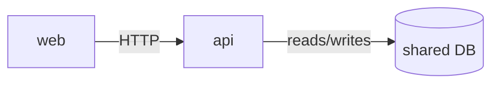

# Codebase Onboarding / Mapping

Build a durable, reusable understanding of a codebase's structure and conventions, and persist it as CLAUDE.md so future tasks (by this agent or any other) don't have to re-discover it from scratch.

## Hard Rules

- **Never write task-specific findings into CLAUDE.md.** "Which files are relevant to task X" belongs in a task/PR doc, not here. CLAUDE.md must stay true regardless of what task is running. If you're invoked mid-task with a specific question, answer inline and only persist the durable parts (see "Scoped mode").
- **Never do an unbounded deep read.** Cap directory listing depth, sample files instead of reading every file, and treat generated/vendor/build directories as opaque. If the codebase is large, breadth-first triage beats exhaustive reading.
- **Never blindly overwrite an existing CLAUDE.md.** If one exists, diff-update it (see "Update mode"), preserving any human-written content.
- **Do not proceed past detection if the architecture shape is ambiguous.** Ask the user to confirm rather than guessing wrong and mapping the wrong thing.

## Workflow

### Step 0 — Detect architecture shape

Look at the currently opened folder (depth 1-2, ignore `node_modules`, `.git`, `dist`, `build`, `vendor`, `.venv`, `target`, `__pycache__`).

1. Find every "source root" = a directory containing its own manifest/build file: `package.json`, `pyproject.toml`, `requirements.txt`, `go.mod`, `Cargo.toml`, `pom.xml`, `build.gradle`, `composer.json`, `Gemfile`, `*.csproj`.
2. Check for monorepo tooling markers at root: `pnpm-workspace.yaml`, `turbo.json`, `nx.json`, `lerna.json`, `rush.json`, or a `workspaces` field in root `package.json`.
3. Classify:

| Signal | Shape |
|---|---|
| Root itself is a source root, no other subdir has a manifest | **Single source** |
| Exactly 2 source roots, named like `frontend/backend`, `client/server`, `web/api`, `ui/api`, `app/api` | **Split (FE/BE)** |
| 3+ source roots, or source roots live under `services/`, `apps/`, `packages/`, or monorepo tooling markers present | **Multi-source (microservices/monorepo)** |
| Root has no manifest anywhere findable at depth 1-2, or signals conflict | **Ambiguous** |

4. If **Ambiguous**, stop and ask the user to confirm (use `ask_user_input_v0` if available, otherwise ask inline) — offer the shapes above as options plus "something else, let me describe it".
5. State the detected shape back to the user in one line before proceeding (e.g. "Detected: monorepo with 4 services — api, worker, web, admin").

### Step 1 — Branch by shape

- **Single source** → run "Per-Source Scan" once at root → write one `CLAUDE.md` at root using the Full Template.
- **Split (FE/BE)** → run "Per-Source Scan" once per side → write `CLAUDE.md` inside each side using the Full Template → write root `CLAUDE.md` using the Root/Pointer Template.
- **Multi-source** → run "Per-Source Scan" once per source root (parallelize via subagents if available, otherwise sequentially, cheapest sources first) → write `CLAUDE.md` inside each source using the Full Template → write root `CLAUDE.md` using the Root/Pointer Template.

Never write a Full Template's worth of detail into the root file when there's more than one source — that's what per-source files are for. The root file's whole job is "what exists + where to look", not "how it works".

### Step 2 — Per-Source Scan (run once per source root)

Scoped to that source's own directory tree only; do not cross into sibling sources.

1. **Manifest & tooling** — read the manifest file, lockfile presence, README if present.
2. **Directory map** — list depth 2-3, one-line purpose per notable folder, explicitly mark generated/vendor dirs to ignore.
3. **Entry point & primary flow** — find the actual entry file (main/index/app/cmd), trace one representative request/data flow through the layers it touches.
4. **Conventions** — naming, error handling pattern, test layout/framework, lint/format config, any ADRs or internal docs found.
5. **Build/run/test commands** — exact commands, required env vars/config (names only, never values/secrets).
6. **Risk areas** — untested regions, deprecated deps, in-progress refactors, anything flagged "don't touch without asking" in comments/docs.
7. **Open questions** — things that can't be inferred from code (business rules, historical decisions) — list them, don't guess.

Use test files as a shortcut for understanding conventions faster than reading source line-by-line.

### Step 3 — Synthesize & write files

Apply templates below. For multi-source, also produce a relationship view for the root file: how do the sources talk to each other (HTTP, message queue, shared DB, shared package)? A short mermaid diagram is ideal here.

### Step 3b — Offer to generate `init.sh` (if absent)

If the repo has no bootstrap/setup script (`init.sh`, `setup.sh`, a `bootstrap` script, or an equivalent Makefile target):

1. Ask the user once: "No setup script found — generate one from the scan results? (y/N)".
2. If yes, write `init.sh` at the repo root from the build/run/test commands the scan just collected: install dependencies per source root → check required env vars are set (names only — never embed values) → build → run a smoke test. One function per source; multi-source roots call each in order.
3. Make it idempotent (safe to re-run) and executable. Reference it in the generated CLAUDE.md Build/Run section: "fresh clone → run `./init.sh` first".
4. If the repo already has ANY setup script or CI-based bootstrap, leave it alone — do not write a competing one.

### Step 4 — Update mode (CLAUDE.md already exists)

- Look for `<!-- AUTO-GENERATED:START -->` / `<!-- AUTO-GENERATED:END -->` markers.
- If present: regenerate only the content between markers; leave everything outside untouched (that's human-added).
- If absent (pre-existing hand-written CLAUDE.md): don't silently wrap/replace it. Show the user a proposed merged version and ask before writing.
- Always regenerate from a fresh scan — don't assume yesterday's map is still accurate; codebases drift.

### Step 5 — Scoped mode (invoked mid-task, not a full onboarding run)

If another skill or the user needs "just tell me about module X" without a full re-map:
- Do the Per-Source Scan steps but limited to the relevant subtree only.
- Answer inline in the conversation.
- Only touch CLAUDE.md if you learned something durable and generically true (e.g. a convention you missed) — append it under the AUTO-GENERATED section, don't create a new file for it.

## Templates

### Full Template (one per source — lives at `<source>/CLAUDE.md`)

```markdown
<!-- AUTO-GENERATED:START (codebase-onboarding, last scanned: YYYY-MM-DD) -->
# <source-name>

## Overview
What this service/app does, in 2-4 sentences. Language, framework, runtime.

## Directory Map
- `path/` — purpose (one line)
- ...(only notable dirs; note what's generated/ignorable)

## Entry Point & Flow
- Entry file: ...
- Representative flow: A → B → C (one real example, not abstract)

## Conventions
- Naming: ...
- Error handling: ...
- Testing: framework, location, how to run one test
- Lint/format: ...

## Build / Run / Test
```
<exact commands>
```
Required env vars (names only): ...

## Risk Areas
- ...

## Open Questions
- ...
<!-- AUTO-GENERATED:END -->

<!-- Add your own notes below — this section is preserved on regeneration -->
```

### Root/Pointer Template (only for multi-source — lives at `./CLAUDE.md`)

```markdown
<!-- AUTO-GENERATED:START (codebase-onboarding, last scanned: YYYY-MM-DD) -->
# <repo-name> — Overview

## What this repo is
1-3 sentences. Shape: split | monorepo/microservices, N sources.

## Sources
| Source | Path | Purpose | Details |
|---|---|---|---|
| api | `services/api` | REST backend | see `services/api/CLAUDE.md` |
| web | `services/web` | Frontend | see `services/web/CLAUDE.md` |

## How sources relate


## Shared/root-level conventions
Only things true across ALL sources: shared CI config, shared lint/style, monorepo tool commands (e.g. `pnpm -w run build`), shared secrets/config strategy. If nothing is shared, say so.
<!-- AUTO-GENERATED:END -->

<!-- Add your own notes below — this section is preserved on regeneration -->
```

## Red Flags and Rationalizations

| Rationalization | Why It's Wrong | Do Instead |
|---|---|---|
| "It's one repo, I'll just write one big CLAUDE.md" | Buries per-service detail, bloats context for every task regardless of which service it touches | Detect shape first; split when there's more than one source |
| "I'll read every file to be thorough" | Burns context, doesn't scale, most of it is noise | Depth-limited listing + sampling (tests, manifests, entry points) |
| "CLAUDE.md exists, I'll just append my findings" | Silently duplicates/contradicts existing content, no way to tell generated vs human content apart later | Use AUTO-GENERATED markers, regenerate that section only |
| "This task needs module X, let me note that in CLAUDE.md for next time" | Task-specific relevance isn't durable — next task needs a different module | Keep task-specific findings out of CLAUDE.md entirely |
| "Shape is kind of ambiguous but probably microservices" | Wrong shape → wrong file layout → wasted work and a misleading root file | Ask the user to confirm when detection signals conflict |

## Validation

- Detected shape stated to the user and (if ambiguous) confirmed by them.
- One `CLAUDE.md` per source root, using the Full Template, scoped only to that source.
- If multi-source: exactly one root `CLAUDE.md` using the Root/Pointer Template — no source-level implementation detail leaked into it.
- No task-specific content in any CLAUDE.md.
- AUTO-GENERATED markers present in every generated/updated file; any pre-existing human content preserved outside them.
- If `init.sh` was generated: idempotent, references only env var names (no values), and did not overwrite any pre-existing setup script.
- Summarize to the user: shape detected, files written/updated, and top 2-3 open questions that need a human answer.